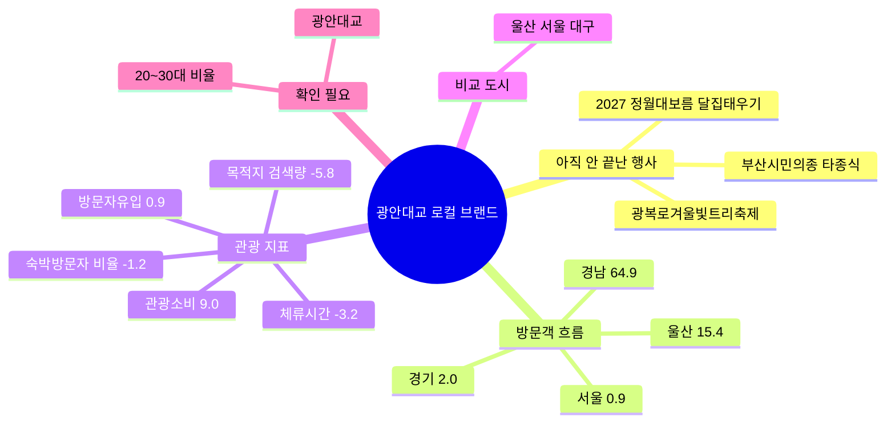

# 부산 지역 키워드 맵 · {이름} · {트랙}

> 키워드 하나 = 리서치 노트 하나. 노트를 만들면 '노트' 칸에 파일 이름을 적습니다.
> 출처를 확인하지 못한 키워드는 '상태'에 `확인 필요`로 둡니다.
> 키워드는 12개 이상 채웁니다.

## 가운데 질문

광안대교를 배경으로, 부산 밖에서 오는 20~30대가 돈을 쓰게 만드는 로컬 브랜드 페르소나는 누구일까?

## 고른 기준 (prompts/01-keyword-map.md)

| 순위 | 기준 |
|---|---|
| 1순위 | 최근 2년 안의 공공기관 데이터로 출처가 분명한 것 |
| 2순위 | 내 산출물이 수익으로 이어지는 구조인가 |
| 3순위 (Claude가 정함) | 광안대교·수영구와 가까운가, 또는 부산 밖 방문객과 직접 이어지는가 |

> 행 번호는 모두 엑셀 행 번호(1행 = 머리글)입니다. 숫자는 파일 값 그대로입니다. 단위는 %입니다.
> '이미 끝난 행사'는 오늘(2026-11-12) 기준 `축제종료일자`가 지난 행으로 봤습니다.

## 키워드 표

| 묶음 | 키워드 | 왜 골랐나 (셀 수 있는 것·숫자·분모) | 근거 (inputs 파일 엑셀 행 또는 URL, 확인일) | 노트 | 상태 |
|---|---|---|---|---|---|
| 아직 안 끝난 행사 | 광복로겨울빛트리축제 | 2026-12-04~2027-01-31, 두 달 가까이 이어지는 겨울 야간 행사. 외지 방문객이 머무는 기간이 긴 행사 | busan_festivals.csv 45행 (2026-11-12 읽음). 홈페이지 칸 비어 있음 | — | 확인함 |
| 아직 안 끝난 행사 | 부산시민의종 타종식 | 2026-12-31 하루. 연말 일정으로 부산을 찾는 방문객 장면 | busan_festivals.csv 46행 (2026-11-12 읽음) | — | 확인함 |
| 아직 안 끝난 행사 | 2027 정월대보름 달집태우기 | 2027-02-21 하루, 금정구. 다음 해 첫 행사 | busan_festivals.csv 47행 (2026-11-12 읽음). 홈페이지 칸 비어 있음 | — | 확인함 |
| 방문객 흐름 (유입) | 경상남도 → 부산 64.9 | 부산 유입 1위. 분모 = 부산 유입 전체 비율 | datalab_related_regions.csv 2행 (2026-11-12 읽음) | — | 확인함 |
| 방문객 흐름 (유입) | 울산광역시 → 부산 15.4 | 유입 2위. 경남과 합쳐 가까운 지역이 대부분 | datalab_related_regions.csv 3행 (2026-11-12 읽음) | — | 확인함 |
| 방문객 흐름 (유입) | 경기도 → 부산 2.0 | 수도권 유입. 먼 지역 방문객 크기를 보는 기준 | datalab_related_regions.csv 6행 (2026-11-12 읽음) | — | 확인함 |
| 방문객 흐름 (유입) | 서울특별시 → 부산 0.9 | 수도권 20~30대를 노린다면 분모가 작다는 신호 | datalab_related_regions.csv 8행 (2026-11-12 읽음) | — | 확인함 |
| 관광 지표 (전년 동기 대비) | 관광소비 9.0 | 5개 지표 중 유일하게 크게 오름. 수익 구조(2순위)와 바로 이어짐 | datalab_diagnosis.csv 6행 (2026-11-12 읽음) | — | 확인함 |
| 관광 지표 (전년 동기 대비) | 체류시간 -3.2 | 머무는 시간이 줄어듦. 짧게 들르는 방문객 상품의 근거 | datalab_diagnosis.csv 4행, datalab_stay.csv 2행 (같은 값) (2026-11-12 읽음) | `research/2026-11-12-stay-time.md` | 확인함 |
| 관광 지표 (전년 동기 대비) | 숙박방문자 비율 -1.2 | 자고 가는 방문객 비율이 줄어듦 | datalab_diagnosis.csv 3행, datalab_stay.csv 2행 (같은 값) (2026-11-12 읽음) | — | 확인함 |
| 관광 지표 (전년 동기 대비) | 목적지 검색량 -5.8 | 5개 지표 중 가장 크게 떨어짐. 브랜드가 '찾아보게 만드는' 일을 해야 할 이유 | datalab_diagnosis.csv 5행 (2026-11-12 읽음) | — | 확인함 |
| 관광 지표 (전년 동기 대비) | 방문자유입 0.9 / 방문자 증감률 0.8 | 방문자는 조금 늘었음. 두 파일 값이 달라 같은 지표인지 알 수 없음 | datalab_diagnosis.csv 2행, datalab_visitors.csv 2행 (2026-11-12 읽음) | — | 확인 필요 (두 값 차이) |
| 비교 도시 | 유사지역 울산·서울·대구 | 데이터랩이 부산과 비슷하다고 묶은 3곳. 경쟁 도시 비교 틀 | datalab_similar_regions.csv 2~4행 (2026-11-12 읽음). 비슷하다고 본 기준은 파일에 없음 | — | 확인함 |
| 장소 | 광안대교 | 기획 목적의 배경 장소. 사진이 필요한 장소 | inputs에 광안대교 행 없음. 광안리 행(17·18·44행)은 모두 끝난 행사 | — | 확인 필요 |
| 타깃 | 20~30대 방문객 비율 | 타깃 연령의 분모 | inputs에 연령 컬럼 없음 | — | 확인 필요 |

## 뺀 것

| 뺀 행·키워드 | 이유 |
|---|---|
| busan_festivals.csv 엑셀 2~44행 (43행) | 이미 끝난 행사. 종료일이 2026-11-07(44행 부산불꽃축제) 이전 |
| busan_festivals.csv 2~5행 (서면 빛축제, 장림항 부네치아 아트프리마켓, 감천문화마을 골목축제, 제28회 UN평화축제) | 이미 끝난 행사. 이 중 3~5행은 2025년에 끝남 |
| busan_festivals.csv 17행 광안리어방축제, 18행 제24회광안리어방축제 | 이미 끝난 행사(2026-06-14) + 같은 축제 중복(17행 한국관광공사, 18행 수영구) |
| busan_festivals.csv 44행 부산불꽃축제 (광안리해수욕장) | 이미 끝난 행사(2026-11-07). 광안대교와 가장 가깝지만 조건에 걸림 |
| busan_festivals.csv 13행 / 15행 해운대 모래축제 | 이미 끝난 행사 + 같은 축제 중복(날짜·장소 같음) |
| busan_festivals.csv 27행 / 28행 부산국제록페스티벌 | 이미 끝난 행사 + 같은 축제 중복 |
| busan_festivals.csv 32행 / 33행 동래읍성역사축제 | 이미 끝난 행사 + 같은 축제 중복 |
| datalab_related_regions.csv 17~31행 (유출 15행) | 부산에서 나가는 흐름. 타깃(부산 밖 방문객)과 맞지 않음 |
| datalab_related_regions.csv 16행 제주특별자치도 → 부산 0.0 | 값이 0.0이라 키워드로 쓸 근거가 없음 |
| busan_markets.csv | 아직 없음 |
| busan_commercial_summary.csv | 아직 없음 |

## 가설 (기관이 밝히지 않은 이유)

- 가설: 관광소비는 9.0 올랐는데 체류시간(-3.2)과 숙박방문자 비율(-1.2)은 줄었다. 짧게 머물며 더 많이 쓰는 방문이 늘었을 수 있다.
- 가설: 서울 유입이 0.9로 작은 것은 거리 때문일 수 있다. 데이터랩이 유입 비율을 어떻게 셌는지는 이 파일에 없다.
- 가설: 방문자 증감률이 0.8(datalab_visitors.csv)과 0.9(datalab_diagnosis.csv)로 다른 것은 계산 기준이 달라서일 수 있다.

## 키워드 사이 연결 (선택)

